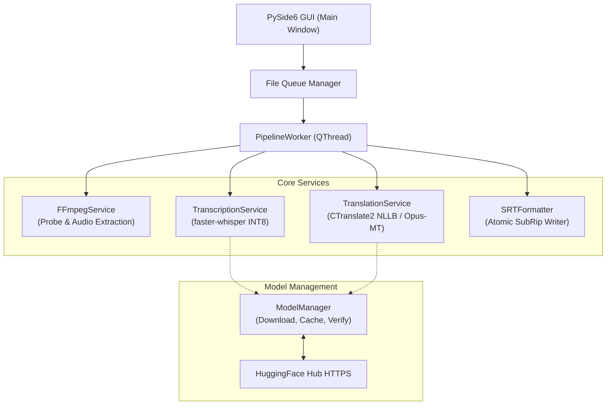

# LocalSub - Architecture and Technical Design

LocalSub is engineered as a modular, decoupled desktop application for Windows 10/11 x64.

---

## 1. System Architecture Overview

---

## 2. Component Breakdown

### `app.core`
- **`types.py`**: Defines domain models (`SubtitleSegment`, `FileQueueItem`), statuses, and language enums.
- **`config.py`**: Handles user configuration (`settings.json`), directory resolutions (`%LOCALAPPDATA%\LocalSub`), and supported video extensions.
- **`srt_formatter.py`**: Pure utility for formatting and parsing standard SubRip subtitles. Enforces `HH:MM:SS,mmm` formatting, UTF-8 encoding, chronological ordering, and atomic temporary-to-destination file replacement.

### `app.services`
- **`ffmpeg_service.py`**: Discovers FFmpeg binary from bundled directory, custom path, or system PATH. Probes containers, detects audio tracks, and extracts 16kHz 16-bit mono WAV. Supports cooperative cancellation and temporary file cleanup.
- **`model_manager.py`**: Manages downloads, SHA/file verification, and caching of Whisper and translation models. Enforces offline operation once cached.
- **`transcription_service.py`**: Wraps `faster-whisper.WhisperModel`. Quantizes model to INT8 on CPU. Locks language to English (`en`). Yields segments with time boundaries.
- **`translation_service.py`**: Provides neural translation with pluggable backends (`CTranslate2NLLBBackend`, `TransformersSeq2SeqBackend`, `MockTranslationBackend`). Preserves segment indices and timing.
- **`pipeline.py`**: High-level orchestrator executing the 6 processing stages for each video file.

### `app.workers`
- **`pipeline_worker.py`**: `QThread` running queue processing in background. Emits thread-safe Qt signals for UI updates.
- **`model_download_worker.py`**: `QThread` handling on-demand model downloads with progress reporting.

### `app.ui`
- **`main_window.py`**: Top-level Qt window with drag-and-drop support, controls, queue list, and execution triggers.
- **`components/`**: Custom widgets including `FileQueueTable`, `ModelSelectorWidget`, and `LogViewerDialog`.
- **`styles.py`**: Dark modern Fluent QSS theme.
